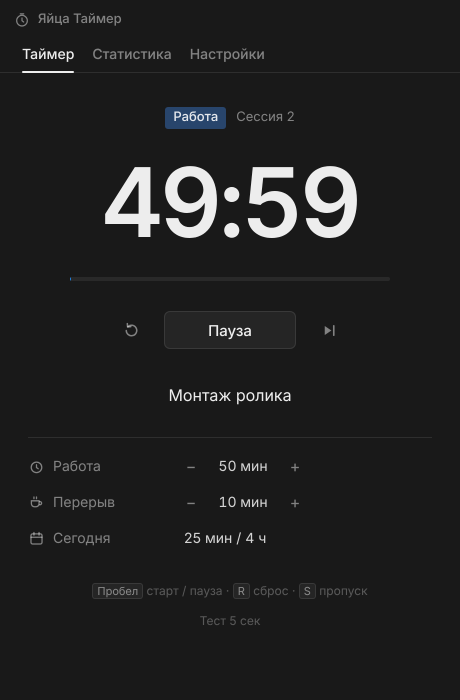
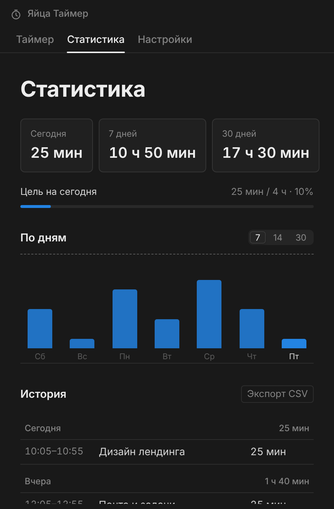
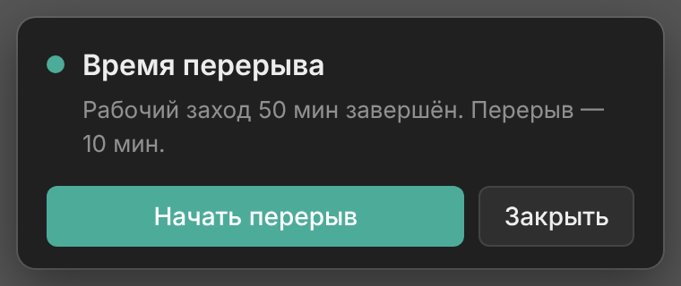

# Яйца Таймер

Помодоро-таймер и учёт рабочих часов для Windows. Минималистичный интерфейс в стиле Notion, тёмная и светлая тема, русский и английский язык.



## Возможности

- **Свои интервалы.** По умолчанию 25/5, работа и перерыв меняются с шагом 5 минут: 50/10, 30/5 — как удобно.
- **Учёт часов.** Каждый рабочий заход записывается вместе с задачей («Над чем работаете?»). Прерванные заходы тоже считаются, если длились от минуты.
- **Статистика.** Сегодня, 7 и 30 дней, график по дням, цель на день, история сессий, выгрузка в CSV для Excel.
- **Напоминание поверх всего.** В конце этапа справа снизу появляется окно поверх любых программ, браузера и видео во весь экран. Оно не исчезает и повторяет звук, пока вы не нажмёте кнопку.
- **Трей.** Крестик прячет окно в трей, таймер продолжает идти. Меню трея: открыть, старт/пауза, тест напоминания, выход.
- **Тест 5 секунд:** проверить звук и окно-напоминание, не трогая таймер.
- Горячие клавиши: Пробел — старт/пауза, R — сброс, S — пропуск этапа.
- **Обновляется сама** при запуске.

| Статистика | Напоминание |
|---|---|
|  |  |

## Установка

1. Скачайте **[YaytsaTimer-Setup.exe](https://github.com/brlk33/Yaytsa-Timer/raw/main/YaytsaTimer-Setup.exe)** и запустите.
2. Выберите папку (права администратора не нужны) и нажмите «Установить».
3. Ярлык **Яйца Таймер** появится на рабочем столе и в меню «Пуск».

Если Windows покажет SmartScreen («Система Windows защитила ваш компьютер») — «Подробнее» → «Выполнить в любом случае»: установщик не подписан платным сертификатом.

## Android

Скачайте **[YaytsaTimer.apk](https://github.com/brlk33/Yaytsa-Timer/raw/main/YaytsaTimer.apk)** на телефон и откройте. Android один раз попросит разрешить установку из этого источника. Нужен Android 8 или новее.

Тот же интерфейс, что на ПК. Пока идёт заход, в шторке висит уведомление с обратным отсчётом и кнопкой паузы. Конец фазы отмечает будильник, поэтому сигнал придёт, даже если приложение закрыто или телефон перезагрузили. Обновляется само, как версия для ПК. Учёт программ и синхронизация с ПК — в следующих версиях.

## Требования

- Windows 10 или 11, 64-бит
- Около 3 МБ на диске: интерфейс работает на встроенном в Windows движке Edge (WebView2), отдельный браузер не скачивается
- Если WebView2 в системе нет (редко, на старых Windows 10), программа сама предложит его скачать

## Данные

История и настройки хранятся в `%APPDATA%\YaytsaTimer\data.json`. При удалении программы они остаются.

## Как устроено

Один `YaytsaTimer.exe` на Go (без cgo): окна, трей и напоминание — Win32, интерфейс (`web/`) — HTML в WebView2. Установщик — NSIS (`installer/installer.nsi`).

Android (`android/`) — небольшая обёртка на Java без Gradle: тот же `web/` в WebView, а `bridge.js` даёт странице тот же `window.focusApi`, что и версия для ПК. Уведомления, будильник конца фазы и самообновление — на стороне Java.

## Сборка

Нужны Go 1.22+ и NSIS (`makensis`); собирается и на Linux.

```
./build.sh
```

APK собирает `build-android.ps1` (JDK 17 и Android SDK: build-tools и platforms;android-36). `build.ps1` вызывает его сам, если SDK установлен. Ключ подписи создаётся при первой сборке вне репозитория, его нужно хранить: без того же ключа телефоны не смогут обновиться.

Новая версия: поднять номер в `version.txt` и `Version` в `main.go`, запустить сборку и закоммитить `YaytsaTimer-Setup.exe`, `YaytsaTimer.apk`, `version.txt`, `latest.yml`. Установленные копии найдут обновление сами (проверка при запуске и раз в 6 часов) и предложат перезапуститься.
